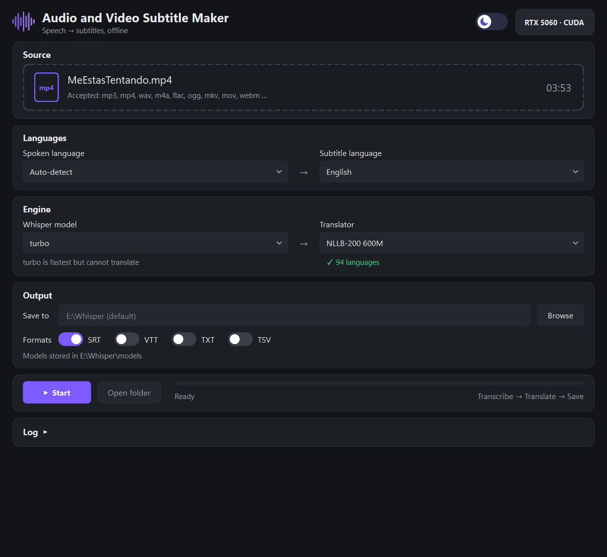
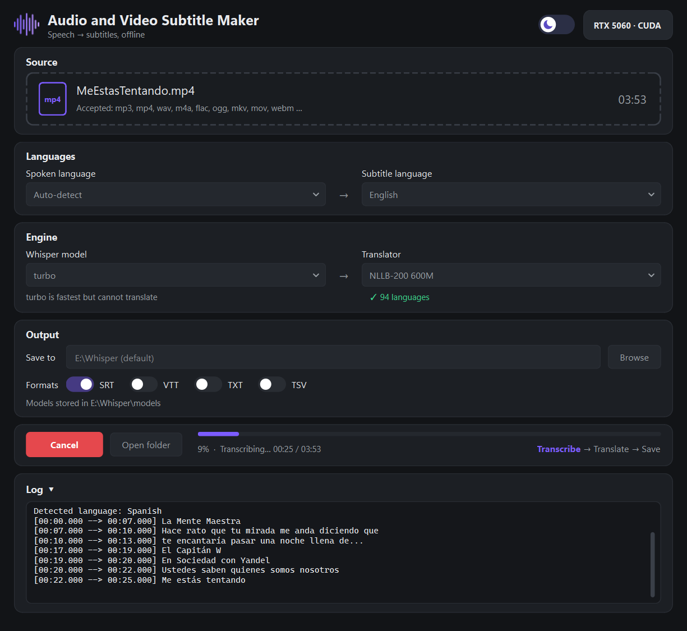
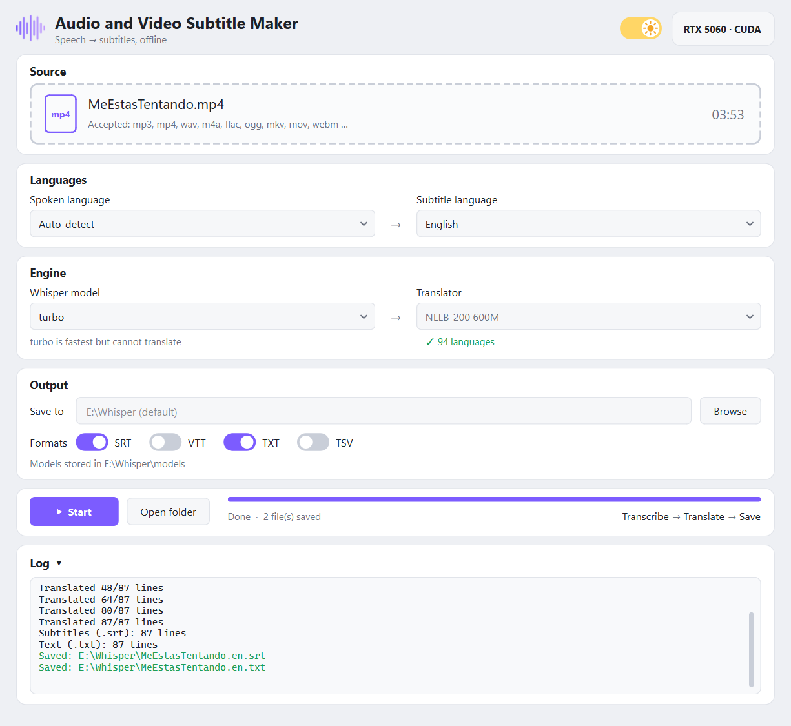
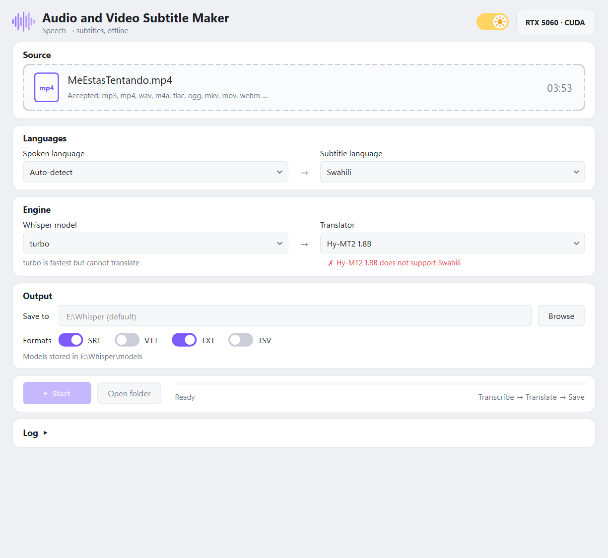

# Audio and Video Subtitle Maker

A Windows desktop app that turns audio or video files into subtitles, using
[OpenAI Whisper](https://github.com/openai/whisper) for speech recognition. It can
also translate the subtitles into another language with a local translation model.
Everything runs on your own PC. Nothing is uploaded.

- Drag in an audio or video file (mp3, wav, m4a, mp4, mkv, mov, webm, …)
- Pick the spoken language, or let Whisper detect it
- Pick the subtitle language: the same language, English, or about 90 others
- Save as **SRT**, **VTT**, **TXT** and/or **TSV**
- Dark and light themes, live progress, and a Cancel button
- All models are stored in `models\` next to the program, not on drive C:

---

## Screenshots

**Ready to start (dark theme).** A Spanish music video is loaded. `turbo` transcribes it and NLLB-200 translates the subtitles into English.



**Transcribing.** Progress, the current step and each recognised line are shown live. Start turns into Cancel.



**Finished (light theme).** The SRT and TXT files are saved, and Open folder is enabled.



**Unsupported language pair.** The translator chip turns red and Start is disabled until you pick a translator that supports the pair.



---

## Requirements

| What | Notes |
|---|---|
| Windows 10/11 | Tested on Windows 11 |
| Python 3.11 | 3.9–3.11 |
| ffmpeg | Must be on your `PATH` |
| NVIDIA GPU (optional) | Strongly recommended. CPU works, but slowly |
| Disk space | ~3–6 GB for models |

---

## Installation

Run each command in PowerShell or Command Prompt.

**1. Install Python 3.11 and ffmpeg**

```powershell
winget install Python.Python.3.11
```

```powershell
winget install Gyan.FFmpeg
```

Open a new terminal afterwards, and check that both work: `python --version` and `ffmpeg -version`.

**2. Install PyTorch**

If you have an NVIDIA GPU, install the CUDA build. RTX 50-series (Blackwell) cards
**need CUDA 12.8 or newer** (`cu128`):

```powershell
pip install torch --index-url https://download.pytorch.org/whl/cu128
```

To run on the CPU only:

```powershell
pip install torch
```

**3. Install the app's packages**

```powershell
pip install -U openai-whisper "transformers>=5.6.0" accelerate sentencepiece PySide6
```

**4. Check that the GPU is detected** (optional)

```powershell
python -c "import torch; print(torch.cuda.is_available(), torch.cuda.get_device_name(0))"
```

It should print `True` and your GPU name.

---

## Starting the app

Double-click **`run.bat`**, or run:

```powershell
python whisper_srt_qt.py
```

---

## How to use

1. **Source**: drag a file onto the dashed box, or click the box to browse. The file name and duration appear.
2. **Languages**
   - *Spoken language*: leave it on **Auto-detect**, or pick the language for better accuracy.
   - *Subtitle language*: **Same as input**, **English**, or any other language.
3. **Engine**
   - *Whisper model*: leave it on **Auto** unless you have a reason to change it (see below).
   - *Translator*: only active when translation is needed. A green chip means the language pair is supported. A red chip explains what is wrong.
4. **Output**
   - *Save to*: the folder for the result. If empty, files are saved next to the program.
   - *Formats*: switch on at least one of SRT, VTT, TXT and TSV.
5. Click **Start**. The log opens and shows each line as it is recognised. Click **Cancel** to stop. It stops after the current segment.
6. When it finishes, click **Open folder** to see the files.

Output files are named `<input name>.<language code>.<format>`, for example
`MeEstasTentando.en.srt`.

---

## Whisper models

| Model | Download | VRAM | Notes |
|---|---|---|---|
| tiny | ~75 MB | ~1 GB | Fastest, least accurate |
| base | ~145 MB | ~1 GB | |
| small | ~485 MB | ~2 GB | Good choice for CPU-only |
| medium | ~1.5 GB | ~5 GB | Used for Whisper's own English translation |
| turbo | ~1.6 GB | ~6 GB | Fast and accurate, but **cannot translate** |
| large-v3 | ~3 GB | ~10 GB | Most accurate. May not fit on 8 GB GPUs |

**Auto** uses `turbo` to transcribe, and `medium` when Whisper itself translates into English.

Each model is downloaded the first time it is used.

---

## Translation

Whisper can only translate **into English**, and `turbo` cannot translate at all.
For other cases, the app first transcribes in the original language and then
translates each subtitle line with a separate model. The original timings are kept.

| Translator | Languages | Download | Licence |
|---|---|---|---|
| Whisper (English only) | any → English | uses Whisper `medium` | MIT |
| NLLB-200 600M | ~90 (of those Whisper knows) | ~2.5 GB | CC-BY-NC 4.0 (**non-commercial**) |
| Hy-MT2 1.8B | ~36 | ~3.6 GB | Apache 2.0 |

- If you pick `turbo` or a non-English subtitle language, the translator switches to **NLLB-200** automatically.
- Only one model is kept on the GPU at a time, so an 8 GB card is enough.
- Hy-MT2 uses random sampling, so two runs on the same file can word lines slightly differently.

---

## Where models are stored

```
models\
├── whisper\   Whisper .pt files (turbo = large-v3-turbo.pt, medium.pt, …)
└── hf\        Hugging Face cache (NLLB-200, Hy-MT2)
```

To free space, delete a model's file or folder. It is downloaded again the next time it is needed.

---

## Project files

| File | Purpose |
|---|---|
| `whisper_srt_qt.py` | The app (PySide6 interface) |
| `whisper_srt.py` | Shared settings, language lists and file writers. Also contains an older, simpler Tk interface |
| `translators.py` | NLLB-200 and Hy-MT2 line translators |
| `run.bat` | Starts the app |
| `assets\` | Small icons created automatically when the app starts |

---

## Troubleshooting

| Problem | Fix |
|---|---|
| `CUDA error: no kernel image is available for execution on the device` or `sm_120 is not compatible` | Your PyTorch is too old for the GPU. Reinstall it with the `cu128` command from step 2. |
| `FileNotFoundError: [WinError 2]` when starting a job | ffmpeg is not on `PATH`. Reinstall it or open a new terminal. |
| Subtitles stay in the original language | You used `turbo` with the Whisper translator. Choose NLLB-200 or Hy-MT2, or the `medium` model. |
| Very slow | Check that the badge in the top-right shows your GPU, not "CPU only". On CPU, use `small` or `base`. |
| Translator says the language is not supported | Pick another translator. NLLB-200 covers the most languages. |
| "unauthenticated requests to the HF Hub" warning | Harmless. Downloads just run at the anonymous speed limit. |

Song lyrics and heavy background music reduce accuracy for any model.
